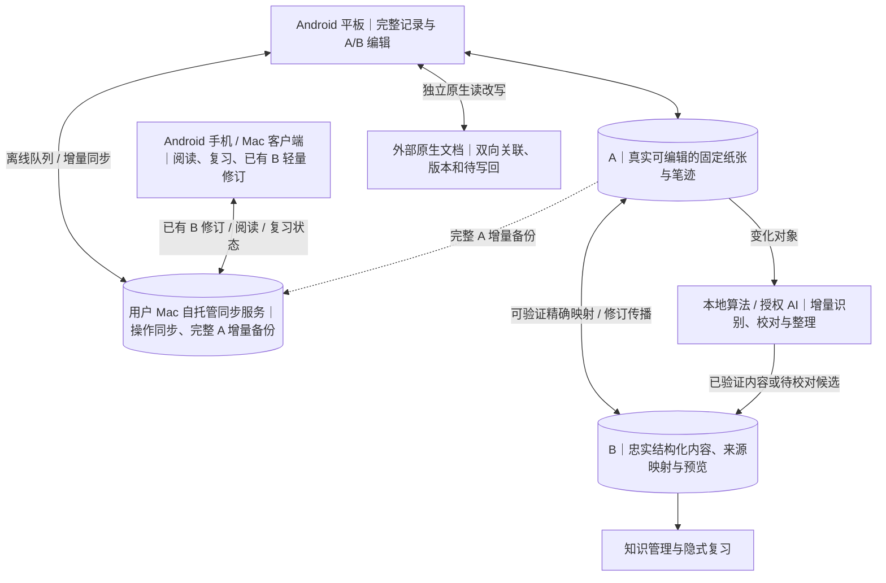

# 笺注 · Glossa

> **想记录时，立刻打开一张纸。先写下来，其余交给系统。**
>
> Glossa 是一款本地优先、以**固定纸张和真实可编辑笔迹**为核心的无纸化笔记系统。它希望保留纸笔记录的低门槛与自由度，同时让后台识别、知识组织、跨设备访问和复习成为自然延伸，而不是书写前必须完成的步骤。

**当前阶段：0.1.2 工程验证版，远非完整产品。** 本 README 同时是项目入口和设计意图索引；`docs/REQUIREMENTS.md` 是详细的已确认需求与实现证据基线。本文描述的**目标行为不代表当前都已实现**。

## 为什么开发 Glossa

现有笔记工具常迫使用户在「自由书写」与「后续检索、整理、复习」之间取舍：数字化纸张记录自然，却难以精细复用内容；结构化笔记易于管理，却容易打断思路。Glossa 希望把这两部分连接起来。

用户可以像拿出一张纸一样，直接写公式、推导、图形和随手记录；之后由系统在后台**忠实识别并建立结构**。同一份知识既保有原稿的布局和笔迹，也能以轻量结构化形式跨设备阅读、修订、检索和复习。无论识别结果是否可靠，**原始记录都不应因此受损或被悄悄改写**。

**这不是** AI 聊天优先、闪卡优先、无限画布优先或必须先创建知识块才能书写的应用；也不是把手写截图转换成摘要后便丢弃原稿的应用。

## 不可妥协的产品原则

1. **记录优先，整理随后。** 默认进入可书写的固定纸张；无需先选择文件夹、创建知识块、连接网络或启动 AI。用户手动加页；复习提醒与任务中心不得抢占记录入口。
2. **原稿是完整、真实且可恢复的数据。** A 保留笔迹、压感、倾斜、图层、坐标和对象等可编辑状态，不可退化为单张图片。离线必须能书写；保存、同步、导出与恢复不能以静默丢笔迹换取便利。
3. **结构化必须忠实，而不是概括。** B 是原稿知识内容的轻量、可编辑表示，并非 AI 摘要。复杂内容可通过可用预览和精确引用保留；A/B 的对象、字符和符号对应关系必须可验证。证据不足时保持未映射并进入校对，绝不猜测后宣称精确。
4. **AI 只能辅助，不得替用户改写知识。** 优先采用可靠的本地确定性算法；仅高置信度错别字可带标记自动修订。公式与知识事实只能提示，不得擅改。AI 操作可检查、可撤销；主动合并修订层须告知其专用独立撤销能力将终止。
5. **用内容身份协调修改，而非用时间覆盖整篇笔记。** 不重叠的并行编辑应保留；真正争夺相同内容时提供双方及原始内容的可视化冲突预览。旧同步响应、旧识别结果不得覆盖新笔迹或新修订。
6. **设备职责有边界。** Android 平板是唯一完整创建和编辑 A/B 的设备。Android 手机和 Mac 可以阅读、复习、整理文件夹/标签、**修改已有 B 知识块内容**；不能创建笔记、纸张或知识块，也不自动获得删除、拆分、合并知识块等结构权限。
7. **原生文件要保留原生语义。** Android 平板独立处理目标格式的读入、对象编辑和写回；动态关联保留源快照、历史、离线待写与冲突，不把导入截图冒充 Office、Keynote 或 Numbers 兼容。未经验证的格式明确标为未实现。
8. **同步属于用户，而不是在线依赖。** Mac 可运行自托管同步服务并增量备份完整 A；Mac 离线不妨碍设备继续记录。普通同步与端到端加密由用户选择；服务器临时解密代理 AI 必须另行明确授权。
9. **复习服务于学习，不统治记录。** 以知识块为单位后台排期，默认隐藏但可查可改；支持 A、B 或对照阅读以及「会/不会」自评，不要求 AI 替用户判断是否掌握。

当「看起来更自动化」与「忠实、可控、可恢复」冲突时，后者优先；当「增加功能」与「立即、流畅记录」冲突时，先保证记录路径。

## 产品工作流与设备边界

| 典型场景 | 目标行为 |
| --- | --- |
| 随时记下一段推导 | 平板打开固定纸张，立刻书写；可暂时没有知识块，停笔后再增量处理 |
| 把原稿用于检索和学习 | 生成忠实的 B 与可验证 A/B 映射；不确定内容保持原样，交由校对 |
| 出门时修正笔记 | 手机/Mac 修改已有 B 文字或公式，经同步后在平板对应 A 位置出现可编辑修订层；无网也能保存本地待同步修改 |
| 同时在两台设备上修订 | 不相交的字符变更自动合并；同一内容的真实冲突由用户预览决议 |
| 把外部文档放入笔记 | 关联对象可与源双向更新、离线缓存写回；超出用户设置的源文件离线时限后冻结独立副本 |
| 设备故障或 Mac 暂时断线 | A 原稿保留在平板本地；恢复后增量补全到 Mac，完整工程包可用于迁移与恢复 |
| 日常复习 | 基于已有知识块安排任务；可切换原稿、结构化文本与对照，用「会/不会」自评 |

### 核心数据路径（目标架构）



这张图解释**产品层面的数据职责**，不是当前部署拓扑、运行进程图或全部功能完成证明。实际工程组织及已验证范围见 [架构与可靠性边界](docs/ARCHITECTURE.md)。

## 当前实现与尚未完成的目标

**0.1.2 是工程验证版。** 目前已存在可操作的开发客户端、Android 原生工程、独立 Mac 同步服务、可恢复的数据内核及部分自动验收。界面采用暖纸、深墨、灰紫工具与编辑式排版，默认进入原稿纸张。仓库初始工作区为空，相关视觉设计从零实现，未复用 Quiet Editorial 的美术资源。

| 项目 | 当前证据边界 |
| --- | --- |
| 纸张编辑、A/B 身份、已有 B 修订、冲突与复习 | 具备内核及开发浏览器范围的实现/测试；不等于 Android 真机手写体验完成 |
| B → A 修订 | **可编辑印刷字体修订层已实现**；仿手写生成仍未实现 |
| Mac 同步、备份及普通/E2EE 模式 | 已有可运行服务与相应测试；真实用户 Mac 公网部署、长期可靠性仍需验收 |
| Markdown、LaTeX 原生文件 | 已有源文本区间适配和 Android 原生文件层的独立验证；完整应用的 JS→原生桥及系统文件选择器流程**尚未通过验收** |
| Office、Keynote、Numbers 原生对象往返 | **未实现**；不可把截图、PDF 或普通文本读写当作支持 |
| Android 0.1.2 完整应用 | APK 可构建，专项文件层和诊断测试有证据；模拟器主页/桥接仍存在未通过场景，不能宣称 Android 完整链路通过 |

以 [交付报告](docs/DELIVERY.md) 为具体版本的真实测试结论，不把旧版本通过记录或编译成功扩大为当前真机已验收。

## 从哪里读起：给使用者与开发 Agent

- **想理解产品目标、权限和功能边界**：先读本 README，再读 [已确认需求—状态—证据表](docs/REQUIREMENTS.md)。
- **想修改数据、同步、映射或修订逻辑**：读 [架构与可靠性边界](docs/ARCHITECTURE.md)；需要核对实际用户行为时读 [可执行验收](docs/ACCEPTANCE.md)。
- **想判断现有代码究竟做到了什么**：读 [交付报告](docs/DELIVERY.md)，而不是仅凭 README、UI 演示或编译成功推断。
- **想开发原生格式**：先读 [原生格式覆盖表](docs/FORMAT-COVERAGE.md) 及 [Android 文档](docs/ANDROID.md)。
- **想处理部署、加密和恢复**：读 [同步文档](docs/SYNC.md)。
- **想处理命名与旧数据兼容**：读 [品牌与兼容约定](docs/BRANDING.md)。

**Agent 工作约束：**产品已确认需求是目标行为；当前技术实现和工程默认参数不是改变需求的依据。遇到需求与代码不一致，应记录为实现缺口；不能静默缩减需求，也不能把尚未验证的行为标注为已实现。对于未确认的产品语义，明确保留待定；工程实现假设需要与用户决策区分。对关键修改补充可复现的正例、反例和失败证据。

下文继续保留具体启动、平台构建、运行和测试说明。

## 启动

需要 Node.js **24**（服务端使用内置 SQLite）。

```sh
npm ci
npm run dev
```

打开终端显示的本地地址（默认 `http://localhost:5173`）。开发服务默认提供明确标注的“开发平板工作台”，用于鼠标、触控笔和自动验收。`?device=phone`、`?device=mac` 可验证只读原稿和已有 B 编辑权限；这些参数只在开发构建有效。

**生产构建的浏览器是阅读/轻编辑端**；不能用放大窗口或 URL 参数解锁平板功能。完整创建端由 Android 原生桥提供固定角色。

```sh
npm run build
npm run preview
```

生产浏览器首次打开为空。可导入 `examples/变化与积累.glossa` 查看、修改已有 B 和复习；完整新建与原稿编辑请安装 Android APK。生产 Service Worker 预缓存本轮所有静态资产，API 不进入缓存；Android 直接从 APK 资产启动，不依赖 Service Worker 或开发服务器。

## Android

构建：

```sh
npm run build
export ANDROID_SDK_ROOT=/path/to/android-sdk
./android/gradlew -p android :app:assembleDebug
adb install -r android/app/build/outputs/apk/debug/app-debug.apk
```

构建产物为 `android/app/build/outputs/apk/debug/app-debug.apk`。安装包是调试验收包，正式发布签名、设备矩阵和升级迁移仍需后续验证。角色来自原生物理显示信息，600dp 较短边区分平板/手机是当前实现假设，折叠屏等须专门验收。

Android 使用系统 WebView 的 Pointer Events 保存真实采样，并通过 SAF 独立读写 Markdown/LaTeX。SAF、原生历史、待写回及编译细节见 [Android 文档](docs/ANDROID.md)。APK 编译、模拟器运行和真实触控笔验证是不同证据，最终结果见 [交付报告](docs/DELIVERY.md)。

0.1.1 的 Android 生产文件层已在 API 35 模拟器通过 71 项新增断言，覆盖文本往返、双版本冲突保护、强制停止后的待写恢复与错误分类。测试使用真实 ContentResolver 和专用文件提供者，不代表系统文件选择器、持久授权或真实触控笔已验。当前安装包为 `releases/glossa-0.1.2-debug.apk`。

0.1.2 新增“运行状态 → 窗口记录”：Android 持久保存最近 8 次可捕获的渲染器退出元数据，不记录笔记正文、文件 URI 或令牌。新增原生持久化 4 项、模拟桥界面 2 项及后续 1 项协议检查各通过一次，旧通过测试未重跑。原模拟器的 WebView 124 故障已缩小到快照校验所用优化计算路径；另用官方旧版模拟器、正常 CPU 配置启动后，完整主页仍未在时限内就绪。主页 JS 桥和系统 SAF 链路仍未通过验收，详见 [本阶段交付与限制](docs/DELIVERY.md) 和 [Android 诊断](docs/ANDROID-WEBVIEW-DIAGNOSIS.md)。

## Mac 自托管服务

客户端与服务器是两个职责：阅读客户端可关闭，服务端仍可作为后台进程运行。

```sh
npm run build
export GLOSSA_TOKEN='替换为至少24字符的随机访问令牌'
npm run server
```

默认仅监听 `127.0.0.1:8787`，数据库在 `server-data/`。真实客户端在“设置 → Mac 同步”填写 HTTPS 地址、令牌及相同工程标识。空阅读端可以通过工程标识拉取既有工程；已有不同工程须先导入正确工程。端到端加密口令只保留当前客户端会话，重启需解锁；服务器拒绝混合模式与错误密钥。

局域网、互联网 HTTPS、Tailscale、Caddy、launchd、SQLite 一致性备份与恢复的完整步骤见 [同步文档](docs/SYNC.md)。这里提供的是可运行服务及部署配置；没有用户 Mac/域名访问条件时，不会把 Linux 的 HTTP 测试称作真实 Mac 公网验证。Mac 临时解密 AI 代理尚未开放。

## 当前操作闭环

- 平板“一张新纸”即创建固定纸张，无需先建知识块。支持 A4/B5/自定义比例、横竖、点阵/横线/方格/空白，手动加页。
- 钢笔保存位置、压力、倾斜、时间与图层；框选移动、局部橡皮、键盘文字/公式和图片可以混排。长按已有对象查看对应 B；B 菜单跳转至当前有效 A 修订。
- 停笔/离开笔记按变化对象增量整理。文字、公式、分类、几何、结构、复习有独立开关和状态。未配置识别服务时保留笔迹并进入校对，不会显示伪造识别结果。已有键盘文字可确定性提取。
- 已有 B 文字/公式以真实选区和稳定字符身份编辑，保存到操作日志。非重叠字符编辑合流，同一内容争用进入校对中的冲突预览。
- B 修订在原位置创建独立可编辑印刷层。平板“修订与历史”可独立撤销或明确确认不可逆合并；通用故障恢复历史仍保留。
- 复习按知识块离线排期，可切 A/B/对照、自评“会了/还不会”，固定间隔与可插拔自适应算法均可运行。当前 adaptive 是 FSRS 启发式，不是经过验证的完整 FSRS 模型。
- 原生 Markdown/LaTeX 可选择源对象插入纸张，并保留完整源快照、历史和待写队列；未经证明的源对象重定位进入人工确认，不能靠坐标或文件名猜。
- 导出完整 `.glossa` 工程恢复原始 A/B、映射、对象/版本、知识关系、复习及源快照。Markdown/独立 HTML 是另行提供的 B 阅读快照，不能替代完整恢复包。

## 验证

```sh
npm test
npm run build
```

浏览器验收默认使用 `/usr/bin/chromium`，可用 `CHROMIUM_PATH` 指向本机浏览器。统一脚本会自行启动独立、禁热更新的本地测试服务并在结束时关闭，避免验收被开发时的文件变化中断。

```sh
npm run test:browser
npm run test:offline
```

Android 原生往返使用单独 instrumentation APK，命令见 [Android 文档](docs/ANDROID.md)。所有最终测试数量、通过/未执行和证据路径统一记录在 [交付报告](docs/DELIVERY.md)，避免把编译成功当作设备功能通过。

## 数据边界与后续开发

- [已确认需求—实现状态—证据表](docs/REQUIREMENTS.md)
- [架构与实现决策](docs/ARCHITECTURE.md)
- [人工验收与后续任务](docs/ACCEPTANCE.md)
- [原生格式覆盖表](docs/FORMAT-COVERAGE.md)
- [B 导出边界](docs/EXPORT.md)

必须保留的高风险目标包括：真实手写字符/符号到 A 笔迹的可验证映射、风格仿写、多设备真机手感/掌触/故障恢复、复杂原生格式完整往返、真实 Mac 公网同步、跨页人工定位、系统通知和桌面小组件。详细缺口逐项记录，不以“已支持笔记/同步/Office”等概括替代。

当前手机/Mac 客户端仍同步完整工程操作日志；已有独立 B 阅读快照，但尚未完成只拉取 B/局部预览的轻量网络通道。当前原生文本读写上限为每文件 16 MiB，图片导入覆盖 PNG/JPEG/WebP 且单张 10 MiB；完整工程导出另走持久分块流，不沿用源文本的 16 MiB 上限。附件分块同步和超大原生历史的单操作拆分仍是后续任务，容量边界见同步文档。

平板知识块可按已有段落拆分、合并及跨笔记关联，保留旧块身份的别名和结构档案；段内进一步切分和跨页人工落点仍需扩展。实现与验证见 [知识块管理](docs/BLOCKS.md)、[书写渲染测量](docs/ink-performance.md)。

源码按数据内核、持久化、自动化、复习、同步、格式、导出、原生适配与交互模块分开。新增格式/算法应加真实往返/行为证据，优先保护原稿和可迁移性。

命名与原地升级兼容约定见 [笺注 / Glossa 命名变更](docs/BRANDING.md)。旧 `.quietpaper` 工程仍可导入；数据库与加密身份保持兼容。
