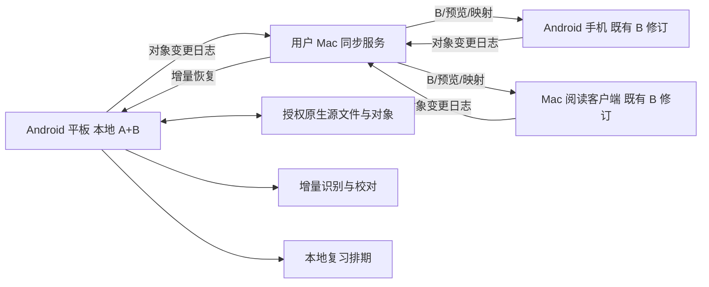

# 架构与可靠性边界

本文件记录工程决策及其验证边界。产品语义见 [REQUIREMENTS.md](REQUIREMENTS.md)，逐项人工流程见 [ACCEPTANCE.md](ACCEPTANCE.md)。初始仓库为空；没有迁移或废弃旧代码。

## 进程与数据职责

服务器不是内容冲突的全篇最后写入胜出者，也不是 Android 的必需在线依赖。服务器职责是认证、持久化和传输操作/备份；客户端保有离线工作副本，按稳定内容身份合并。完整 A 的主要实时工作副本仍在 Android 平板。

## 共享代码与平台宿主

共享数据内核使用 TypeScript，交互客户端使用 React。Android 宿主负责平台角色、离线资源和用户授权文件访问；Mac 服务器是独立 Node 进程。共享 UI 的桌面浏览器运行结果不证明已交付原生 macOS 客户端，Android WebView 容器编译成功不证明真实手写体验完成。

权限由宿主与内核共同约束，不能只依赖响应式布局。手机和 Mac 可以修订已有 B 块内容，但不能通过编辑器、导入或 API 隐式新增笔记/块，也没有未明确授权的块删除/拆分/合并权限。

## A/B 与身份

A 保存固定纸张及真实可编辑对象：笔迹点、压力、倾斜、坐标、图层、文本与插入对象。B 保存忠实结构和实际源对象引用；字符/符号级身份与对象身份需独立存在，重排不能重建身份。复杂图形无法结构化时，B 仍应有完整可读的引用与预览。

映射状态应区分已验证精确、未确认候选和未映射。文本相似度、矩形相交或阅读顺序推测都不足以建立精确映射。识别器不能把无法解释的来源关系悄悄变成已确认。

当前代码保存对象 UUID、来源版本和稳定 B 字符身份。`glyphIds` 必须解析为相应 `sourceObjectId` 中真实存在的 A 对象；每个字符明确对应不重复的实际对象时才能标为字符精度，把同一整条笔迹重复分配给多个字只算对象精度。任意虚构 glyph 字符串会被拒绝。自动字形分割、真实笔迹采样区间和跨学科识别仍未实现或未验证，稳定 B 字符 ID 不代表这些目标已完成。

块语义顺序和逻辑边不要求等于纸面坐标；块可跨页，不可嵌套。调整逻辑不得自动重排 A。知识关系和文件关联也需要稳定身份，不能只靠标题或路径。

平板已提供按已有段落边界拆块和合块的内核及管理界面，段落/字符/来源身份保持，块版本与关系/复习状态随结构操作迁移；竞争同一段落归属进入结构冲突。手机/Mac 不提供这些操作。导入已有工程只恢复既有身份，不能藉此获得创建或结构编辑权限。

## 操作、冲突与修订层

增量操作以实际对象/字符为粒度；服务器传输与去重不能消除冲突的任一方。因果上先后的有效修改可以更新相应内容，真正并发争夺同一身份的变更必须进入冲突预览；同公式不同字符不应因为同属一个字符串而被互相覆盖。字符编辑器应调用显式 `editRange`/`editCharacters` 保存选择范围；对重复符号，仅传最终全文可能丢失编辑意图，内核会拒绝已识别的歧义而非猜测。

B 修改对应手写内容时创建原位置独立修订层。当前阶段可先走已确认的印刷文字兜底；它应保持可编辑，并保留后续仿手写重试能力，而非用位图替代。独立撤销需要安全逆变更或屏蔽此次操作，不能重置整张页面。若后续操作依赖该修订，必须可视化选择。

主动合并是明确的生命周期终点：提示不可逆后，内容成为普通笔迹，清除该修订的来源区分及专用逆记录；一般版本恢复与普通故障保护继续存在，不能借合并丢失其他内容。

## 本地持久化与恢复

本地 IndexedDB 严格事务保存操作和同步游标，提交完成后才报告已存；`transact` 对失败的多步骤操作整体回滚，`waitForSave` 让外部写回等待本地耐久化。保存返回没有新增事件时不重复回放全工程，减少书写路径中的后台工作。

每个打开页面分配独立单写者 ID；安装 ID 单独用于原生源授权归属。笔迹检查点按写者隔离，消费时比较确切草稿，不能删掉更新手势或其他窗口检查点。未完成草稿可在恢复入口查看、导出或在确认原窗口停止后恢复。

普通保存只合并同一工程、同一 epoch 的不可变日志。显式导入/恢复在一个事务中保存当前恢复副本、精确替换所选工程并更新 epoch；同 ID 的旧包不会被默认日志 union 悄悄改回新版本。旧窗口的 CAS 保存被拒绝，并保留其独立恢复副本。BroadcastChannel 使该窗口停写，用户仍能导出。

恢复列表提供原生工程导出和有明确确认的版本恢复；恢复前的当前笔迹又进入新的恢复副本。完整工程包包含 A/B、映射、历史、块、关系、复习、同步必要元数据和外部源快照；独立 HTML/Markdown 是 B 阅读快照，不冒称可编辑 A。Android 导出暂存失败可在恢复列表继续或经确认清理；浏览器模拟桥验证不代替真实 SAF。

故障不丢数据是长期可验证的不变量；单次刷新成功不足以证明。配额耗尽、写入中断、损坏包、服务器重启和设备断电要有独立故障测试。

## 同步与加密

Mac 服务保存幂等操作日志并提供增量拉取。客户端记录成功提交的上传确认集合，后续只发送未确认操作；断网时不阻塞书写，恢复后重试。每次连接捕获项目 ID、epoch 和同步 generation，断连/恢复立即失效旧租约；迟到 HTTP 响应不能应用到新的工程、游标或连接状态。同步状态与源文件可用性分开。

普通/E2EE 两模式的真实 Linux HTTP 集成已验证手机/Mac 字符修订回写平板印刷修订层及 SQLite 一致备份恢复 A/B、来源、原生源快照、复习和历史。当前设备同步仍传完整工程日志，还没有 B 专用轻量同步通道；独立 B HTML 阅读快照已能离线查看当前支持的原稿预览。真实互联网部署要由用户拥有的 HTTPS/安全网络入口完成，并验证认证、跨设备和睡眠恢复。

普通模式与端到端加密模式必须显式区分。E2EE 由客户端加解密，服务器不可为了解析内容悄悄降级。密码错误、数据篡改或模式不一致必须失败且保留本地数据。服务器临时明文代理 AI 是独立、尚需实现的权限流程，不能假定已经包含在普通 API 授权中。

## 识别、原生文件和复习

识别按变化对象在停笔/关笔记时调度，各模块独立开关。写入一笔期间暂停闲时任务发布并缓冲在途候选，停笔后再发布；恢复工程会在切换结束后重建处理器并重扫未处理对象，不能沿用旧工程队列。确定性几何处理不调用 AI；OCR、公式和语义处理未配置时保持未配置/待校对，不生成假结果。公式/事实不能自动纠正。外部 API 必须有明确初次授权与撤销，且仅发送处理所需对象。

原生文件适配器承担读入、对象定位、修改、写回与重新打开。Markdown/LaTeX 原文区间操作不能推定 Office/iWork 的复杂语义兼容。默认动态关联保有源快照、待写回操作、版本和真冲突双方；源离线超时才冻结，Mac 服务器离线不参与此判定。移动/重命名的身份判断需平台实测，内容指纹只能是证据之一，不能假装唯一文件身份。Android 桥接提供聚焦/定时重读，App 源协调器在读写前耐久保存意图，在每次异步返回后验证纸张/来源版本；等待期间的新有效 B/A 修改不会被旧结果覆盖。同一旧偏移的已变化对象不自动继承身份，保留源候选并要求显式重新定位。

复习以知识块为单位，完全可以离线自评和排期。块内容日期由该块段落/来源内容事件计算，不会因同笔记其他区域加笔或纯平移重置；独立自评事件保留并行记录。自适应算法的可运行实现与经验证的 FSRS 参数模型应明确区分；任务中心不应抢占纸张入口。

## 当前不能由此架构证明的目标

- Android 真实触控笔自然度、掌触处理、长期可靠性，以及完整原生平台功能。
- 识别模型对跨学科材料的准确性、字符/符号级精确映射和仿手写生成质量。
- Keynote、Numbers、Office 的母版、动画、公式及其他复杂对象原生无损往返。
- 真实 Mac 局域网与互联网部署、长期多设备并发、睡眠恢复和备份耐久性。
- 系统通知、桌面小组件、完整媒体支持，以及服务器最小范围明文代理 AI。

## 可靠性回归证据

- `tests/workspace-safety.test.ts`：多步骤失败回滚、旧同步租约拒绝、块内容日期。
- `tests/storage.browser.mjs`：真实双窗口严格事务、草稿、同 ID 精确恢复、旧窗口 CAS 与可恢复副本。
- `tests/workspace.browser.mjs`：真实 Hook/RecoveryManager 的恢复与重载、当前笔迹保留、恢复后整理、迟到 HTTP 隔离，以及模拟原生导出暂存的失败/重试/确认清理。
- `tests/source.browser.mjs`：真实 App/IndexedDB + 模拟原生桥，验证耐久待写、失败保留、等待中 B 修订、显式重定位与源失联冻结。
- `tests/block-manager.browser.mjs`、`tests/app.browser.mjs`、`tests/export.browser.mjs`：开发浏览器结构操作/权限、端到端记录修订复习、独立 B 阅读。以上均不能替换 Android/Mac 真机、SAF 提供者或互联网测试。
