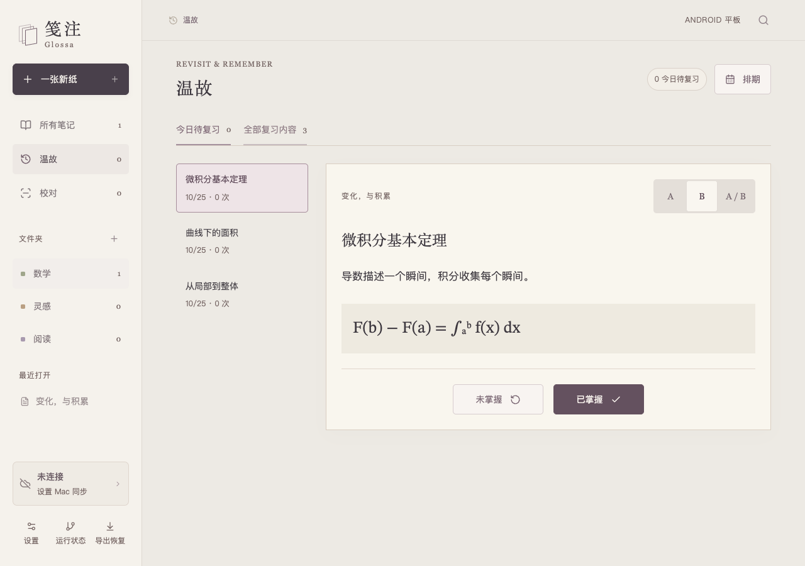
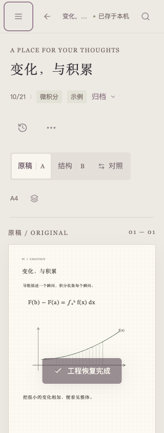

# Android 界面与导航微调

采用 Apple 官方 [Layout](https://developer.apple.com/design/human-interface-guidelines/layout)、[Typography](https://developer.apple.com/design/human-interface-guidelines/typography)、[Motion](https://developer.apple.com/design/human-interface-guidelines/motion) 中关于对齐、清晰层级、适应尺寸和简短反馈的原则。Android 仍使用原生系统返回、输入法与 SAF，不引入 iOS 返回手势、字体文件或新的创建权限。

## 交付行为

- Android 专属样式保留暖纸风格；正文、输入、辅助文字分别按 14/16/12px 基准组织。重要操作区域至少 48px，复习两按钮等尺寸；纸张内容、SVG、笔迹坐标与压力采样逻辑不变。
- 手机面包屑精简为返回与标题；侧栏、阅读方式、页码和复习内容具有明确的无障碍选中状态。关闭的手机抽屉不进入焦点顺序，打开后焦点留在抽屉并在关闭时恢复。
- 动效限于短暂颜色、淡入及抽屉方向反馈；系统减少动态效果同时影响 CSS 与结构内容定位。
- 系统返回按层级处理；未提交表单和知识块名称/选择在放弃前确认，内联 B 修订调用原有明确放弃路径；恢复进行中不退走底层页面。
- 笔记返回列表保留文件夹与搜索，导入/恢复工程重置旧导航条件；落笔期间消费返回并保留当前采样。

## 实际检查

设备为专用 `Glossa_API35_ARM64` AVD，Android 15/API 35、2560×1600、320dpi、WebView 124，沿用原数据且未接触实体设备。

| 检查 | 证据与范围 |
| --- | --- |
| APK 真实系统返回 | [最终结果](native-result.json)、[日志](native-navigation.log)：六项通过；弹窗关闭、IME 优先、拒绝放弃保留输入、合成笔落笔期间不切页、DocumentsUI 取消、根页退出后重开仍有采样 |
| 手机和平板布局 | [浏览器日志](browser-test.log)：文件夹/搜索保留、设置表单保护、等尺寸自评、减少动态效果、抽屉焦点与 320px 手机无页面横溢出；手机不能创建笔记或手写 A |
| 已有应用流程 | `tests/app.browser.mjs` 本轮八组通过：书写与恢复、B 修订/独立撤销、修订合并告知、多页/校对、管理与检索、离线复习、手机/Mac 权限；输出记录在本次开发对话 |
| 修订与知识块弹层 | [结构修订](structure-browser.log)、[知识块](block-manager-browser.log) 均通过，未捕获页面异常 |
| 打包 | [APK 资产](apk-verification.json) 确认 Web 资产逐字节匹配，原文件桥和渲染恢复入口仍在；[签名](apk-signature.txt) 校验通过，为工程调试签名 |

首次原生检查发现 API 35 镜像要求显式 `enableOnBackInvokedCallback=true`，修正后才执行最终六项；最初测试重连误用旧 Activity 状态字段造成的失败日志仍保留在 `artifacts/android-hig-20261023/`。这不是新增数据损坏证据。

合成笔输入不是实体触控笔、掌触或延迟验收；API 26–32 与预测性返回手势预览未做设备验证。本轮没有重跑完整原生源文件往返、全部 SAF 故障、同步或长期耐久测试，也不扩大 Office/iWork 与真实识别模型的支持声明。
