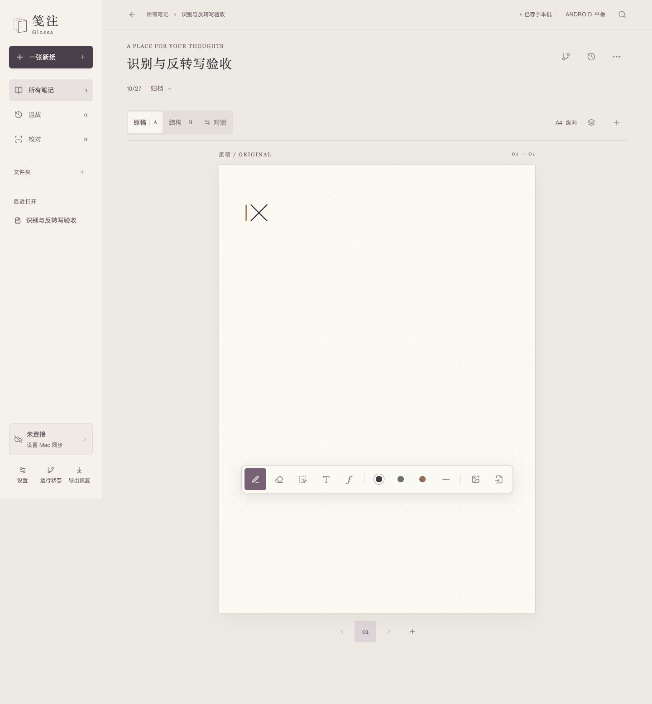

# 文字识别与仿手写验收 · 2026-10-27

## 已通过

| 检查                              | 结果与范围                                                                                                                                                           |
| --------------------------------- | -------------------------------------------------------------------------------------------------------------------------------------------------------------------- |
| [完整 Node 回归](node-tests.log)  | 185/185；含普通/E2EE 真实 HTTP、样本来源验证、并发编辑、完整工程往返、撤销/合并与局部擦除残段                                                                        |
| [Swift 回归](swift-tests.log)     | 20/20；新增真实 JavaScriptCore 导入字形、Mac B 编辑生成笔迹、Swift 模型解码、离线 HTML 与工程恢复                                                                    |
| [识别专项](recognition-tests.log) | Node 专项全部通过；真实 Chrome PNG 栅格裁切/缩放、安全输入；原生桥适配、整组校对、字形学习、B→A、重启恢复、局部擦除后独立撤销、已校对行添笔、多 B 段落识别作用域通过 |
| [macOS 打包](macos-build.log)     | 生产构建通过，内置最新共享内核，ad-hoc 签名及严格签名验证通过                                                                                                        |
| 既有浏览器功能回归                | storage、structure、workspace、source、block-manager 通过；应用交互 8 组和独立 HTML 导出 3 组另行运行通过                                                            |

识别专项中的原生桥返回测试候选，用于验证应用行为；不冒充模型准确性。Android 真实推理验收单列在下方。

## Android 真实模型与交付

- [原生在线验收](android-recognition.log)：29 项通过。真实图片 `HELLO 123`、`中文识别 123`，真实 WebView JavascriptInterface/事件回调；明确下载英文/中文模型后，合成笔画的 `H` 与 `人` 出现在真实模型候选中。不伪造置信度。
- [原生离线验收](android-recognition-offline.log)：最终 APK 上 27 项通过，覆盖上述图片、数字笔迹与桥回调；Wi-Fi 关闭、代理为空、无活动网络，见 [模拟器状态](android-offline-state.json)。模型使用已下载本地副本。
- [Android 构建](android-build.log)通过。测试使用独立 API 35 ARM64 模拟器与合成笔画；不替代实体触控笔或中文准确率语料评估。临时代理删除、Wi-Fi 恢复原始关闭状态，测试启动的模拟器已关闭。
- Android 包：`releases/recognition-20261027/glossa-recognition-debug.apk`，SHA-256 `bb6e7b74a44733c3a2bab0c84fa88f1485566a7449cd8e634a43eb35fcee88ea`；内含 `index-B046tcyX.js`，离线缓存身份 `glossa-7c8526356db7ce38`。
- Mac 包：`releases/macos/Glossa.app` 与 `Glossa-macOS-arm64.zip`。包含相同共享内核与最新服务器网页；本地 ad-hoc 签名，尚非 Developer ID 公证发行包。

## 未通过的既有检查

完整 `npm run test:browser` 在 `tests/ink.browser.mjs:83` 的旧/新轮廓二值像素比较处停止：旧面积 789、新面积 810，差异 21，比例 0.026615969581749048，超过原有 0.02 阈值。使用 Google Chrome 156.0.8078.48。

本轮没有修改该测试或 `src/ink.ts`；后者与 HEAD 的 SHA-256 都是 `026d591ef41522195443b14071289db41cc4286e7ad93fde9ba5a14a83404be3`。未降低阈值或把完整浏览器回归标为通过。被该失败阻断的后续 app/export 已独立运行并通过。

## 能力边界

- 仿手写来自明确确认的单字真实笔迹；缺字、组合字符、公式、溢出、跨页落点未知保留印刷层，不承诺少量字样推断任意未知汉字。
- 端侧/视觉模型输出保留为候选，校对后建立对象级对应；没有把高置信度当作字符级准确映射。
- 真实中文笔迹准确率、复杂数学/化学语料、用户风格满意度、实体笔压力/掌触与跨设备体验需要后续专项评估。
- 新字形与擦除修订操作需要更新两端客户端；本轮 Android 与 Mac 包含相同新内核。
